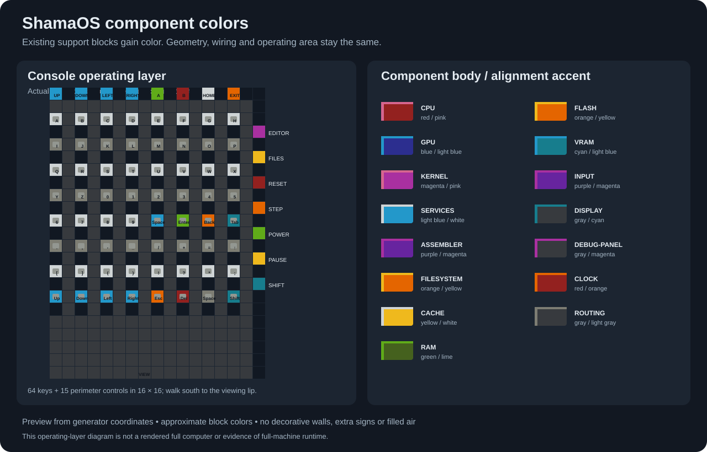

# ShamaOS Redstone PC

A programmable Minecraft Java redstone computer, its ShamaOS software, and the
tools that generate its physical circuitry. Python and Yosys construct the
machine; the design performs CPU, SHA, graphics, memory and filesystem work in
redstone after generation.

**Status: implementation and validation in progress.** Firmware/RTL execution,
actual redstone fixtures, saved-world readback, full synthesis, and complete-world
boot are separate checks. A verified complete ShamaOS Minecraft world has not yet
been released. See [implementation status](docs/IMPLEMENTATION_STATUS.md) and the
[requirements and release gates](docs/REQUIREMENTS.md).

The `99ee940` checkpoint passed
[all 20 CI jobs](https://github.com/Eabusham2/ShamaOS-Redstone-PC/actions/runs/45340047612),
including the behavioral/redstone job, all twelve physical synthesis partitions
and final reconnection. Its separate complete-cache runtime workflow stopped at
a physical clock-route shortage. The reviewed fix is in `6785ca9`; a
[fresh complete-cache run](https://github.com/Eabusham2/ShamaOS-Redstone-PC/actions/runs/45351382058)
and new CI validate the subsequent source separately. Compilation and fixture
success do not establish complete-world boot.

The latest saved-world input fixture has all 32 physical launch registers and
all 512 storage bits connected. It passes 2,048 writes, 38,912 retention checks
and save/reopen; a deliberately delayed control exposes corruption. Its
[recording and scope](experiments/input_registered_bank/README.md) keep event
admission and the eventual input queue separate from that completed bank test.
The [named startup controller](experiments/named_startup_domain/README.md) now
uses the same local physical placement in both generator backends and CI.
Generation checks its complete block states and named signal positions against
the measured circuit; changed wiring requires new timing evidence.
Its reset/power and saved-state tests pass, while upstream counter timing and
whole-machine clock distribution remain open. Required CI separates long
processor/OS simulations from component tests and verifies their exhaustive
combined coverage; synthesis and release checks include the new thirteenth
startup partition.

The [default-height input receiver review](experiments/input_receiver_review/README.md)
independently checks all 141 saved console cases and every retained signal tick,
including the physical clock-skew failure. A fresh engine run and a fresh export
of the Minecraft regions reproduce the retained results. The CPU request/return
connections, packet memory and complete worker still require physical timing;
this component evidence does not activate the unfinished input replacement.

The owner reopened app/cache optimization on November 13, 2026 (America/Chicago). Shared app routines
and explicit one-word instruction forms now reduce all nine executables. The
physical cache is **4 KiB**, retaining the original **8 KiB execution window**
through its existing RAM backing. See the [cache reduction record](docs/CACHE_REDUCTION.md)
for exact byte savings, cache residency, tests and physical-routing scope.
Two block collectors measured **22,805,546 blocks across 118,781 occupied
chunks** for the earlier one-bank fixture with an unguarded write output. The
current controller adds a registered write guard to protect preloaded data
during startup. Its complete connected geometry, clock delivery, transactions
and reopened storage require a fresh run of the
[physical cache validation workflow](docs/CACHE_VALIDATION.md).

Native world creation/readback also has a reviewed fingerprint optimization.
A separate 64-chunk fixture writes about twice as fast and validates about
twice as fast with identical saved digests and decoded states. These local
fixture timings do not predict the complete world's generation time; the
[cache reduction record](docs/CACHE_REDUCTION.md#faster-native-creation-and-readback)
retains the exact scope and measurements.

Complete physical routing, timing, saved-world execution and the final release
remain unfinished. The [bounded generation backend](docs/BOUNDED_BACKEND.md)
connects mapped partitions, exterior contacts and global routing to the world
writer; its complete small test system passes saved-world execution. The default
backend remains `flat`. The earlier full 8 KiB cache geometry and controller
clock proofs remain historical fixtures; the new one-bank cache needs its own
connected saved-world execution proof.

## Agreed machine

| Subsystem | Contract |
|---|---|
| CPU | 32-bit datapath, sixteen registers, full integer/logic/control-flow ISA, separate 256-entry call and data stacks |
| SHA | Native SHA-256/double-SHA execution plus programmable primitives and an independent software implementation |
| Main RAM | **96 KiB physical**, 24 × 4 KiB banks |
| Fast/executable memory | **4 KiB physical**, 1 × 4 KiB bank; original 8 KiB program window retained in RAM |
| Flash | **200 KiB** physical persistent storage, 50 × 4 KiB banks |
| VRAM | **16 KiB physical**, 4 × 4 KiB banks |
| Display | **320×180** monochrome, double buffered, 57,600 lamps |
| Input | 8×8 keyboard with Shift, controller, Home/Exit/Editor/Files, power/reset/pause/manual step |
| OS | Resident kernel, one foreground app, persistent files, in-world assembler/editor |
| Diagnostics | PC, instruction, registers, flags, CPU/stall state, native SHA state/round, faults and usage counters |

The current implementation has **96 KiB RAM, 200 KiB flash, 4 KiB cache and
16 KiB VRAM**. History updates stage a **128-byte record** in existing reserved
metadata, retaining all 256 complete records and interrupted-save recovery.
Editor peaks at **69,748 bytes (70.95% of RAM)** when editing or assembling.
Explorer uses **4,140 bytes (4.21%)** and reads selected files from flash. The complete 65,535-byte source and 16,380-byte
assembly/save limits remain. Miner uses **6.50% RAM**, including its full
software-SHA workspace and 5,004-byte code backing. Its first 4,096 code bytes
occupy cache and the remaining 908 execute from RAM. Its ordinary native-mining
and UI code is entirely within the cached prefix.

The initial flash allocates **144.75 KiB (72.375%)**, including all editable
sources, binaries and persistent records. Two full screen buffers plus
text/sprites fit in **15,680 bytes**; scrolling reserves no third frame.
All shipped programs fit the unchanged 8 KiB execution limit. Larger user
programs can still be assembled/saved and trigger visible recovery on execution.
[Memory design and efficiency](docs/MEMORY.md) separates software allocation,
physical storage, placed blocks, occupied chunks and world file size.

### Per-app software occupancy

One foreground app runs at a time. RAM includes the resident kernel, app code
backing and complete workspace, without optional heap pages. Each app uses the
same shared **15,680-byte VRAM reservation (95.70% of 16 KiB)**. Flash shares
include complete editable source, separate executable, packed loader record and
installed persistent data; shared metadata and documents are counted separately.

| App | Code bytes | RAM bytes | RAM | Cache bytes | Of 4 KiB cache | Attributed flash |
|---|---:|---:|---:|---:|---:|---:|
| Desktop | 184 | 196 | 0.20% | 184 | 4.49% | 0.84% |
| Editor | 3,620 | 69,748 | 70.95% | 3,620 | 88.38% | 11.52% |
| File Explorer | 3,548 | 4,140 | 4.21% | 3,548 | 86.62% | 11.48% |
| Bitcoin Miner | 5,004 | 6,392 | 6.50% | 4,096 | 100.00% | 31.32% |
| System Monitor | 40 | 52 | 0.05% | 40 | 0.98% | 0.40% |
| Terminal | 1,488 | 2,524 | 2.57% | 1,488 | 36.33% | 4.48% |
| Calculator | 1,448 | 1,460 | 1.49% | 1,448 | 35.35% | 4.83% |
| Paint | 696 | 980 | 1.00% | 696 | 16.99% | 2.09% |
| Settings | 608 | 892 | 0.91% | 608 | 14.84% | 1.92% |

Code length and cache residency differ for Miner: the RAM counter already
includes its complete executable, so the 908-byte tail adds no new allocation.

Editor additionally has 20 KiB of allocatable heap, Explorer 84 KiB and Miner
80 KiB. Other apps have 80–84 KiB depending on their workspace. The allocator
protects overlapping workspaces; free bytes are not all interchangeable heap.

Flash's 144.75 KiB consists of **72.75 KiB sources, 17.75 KiB separate executables,
16.5 KiB packed loader, 32 KiB Miner history, 0.25 KiB Miner state, 1 KiB welcome
documents and 4.5 KiB metadata**. It leaves **55.25 KiB free**, with **45.25 KiB**
of allocation headroom before the **190 KiB / 95% write guard**. Copy-on-write
saves also need their temporary replacement extent to fit. Miner history uses
its bounded record journal and needs no replacement extent. At this capacity,
saving a maximum-size source and maximum-size output together can require
reclaiming space first; the OS preserves the previous file if a save cannot fit.
Full byte counts, per-app flash attribution and address maps are in
[MEMORY.md](docs/MEMORY.md); `shamaos software-usage` regenerates the figures from
the actual image.

### Current measured footprint

The default superflat layout starts one block above grass. A shared column
stacks cache's 1 bank, VRAM's 4 and RAM's 24; flash uses two more columns.
The top regular-component geometry reaches Y=304 in the grass-at-Y=-61 world.
All local bank selectors, binary row decoders and read-return wiring are counted.

| Component | Physical capacity | Bank modules | Occupied X/Z chunks |
|---|---:|---:|---:|
| Shared cache + RAM + VRAM column and local wiring | 4 + 96 + 16 KiB | 29 | 7,330 |
| Flash and local wiring | 200 KiB | 50 | 13,886 |
| Screen | 320×180 pixels | — | 108 |
| Keyboard / controller circuitry | — | — | 47 |
| Debug panel | — | — | 9 |
| Clock | — | — | 17 |
| **Measured regular-component subtotal** | **316 KiB memory** | **79** | **21,397** |
| Synthesized CPU/GPU/assembler/OS logic and connecting routes | — | — | **Not yet established** |

The default regular components occupy an envelope of **3,331×6,388 blocks**,
or **209×400 = 83,600 chunks** including gaps. Four-block bit columns and
isolated write-data towers remove 10,031,104 placement operations and 1,931
occupied chunks from the five-block-pitch layout. The resulting subtotal is
**190,035,905 placement operations**. Physical capacity, the upright screen and
the 79 controls are included in the [current geometry report](docs/evidence/four-block-memory-preflight.json).

All 79 input actuators fit a connected, walkable **16×16 activation area**;
47 chunks is the separate backend circuitry. A nearby walking lip provides the
standing view. Conservative ray tests see every lamp past the console and its
30 export paths, and a documented 16:9 perspective contains the whole screen.
The full GPU/bridge/panel replay checks every lamp through 73 actual-engine
steps. In-client legibility with complete-machine routes, global timing and
complete-world boot remain release gates. See [MEMORY.md](docs/MEMORY.md) for per-fabric counts
and [VALIDATION.md](docs/VALIDATION.md) for evidence boundaries.

### Component colors

Existing supports now give each component a distinct color, with simple alignment
stripes: red CPU, blue GPU, green RAM, orange flash, yellow cache and cyan VRAM.
The compact console has a dark deck, alternating keyboard rows and colored
action controls. This adds **no blocks, height, chunks or perimeter**. Functional
blocks and their positions remain unchanged. Saved/read-back memory, display and
all 79 console actuators pass actual-engine checks with the colors applied.



This is an operating-layer diagram generated from actual console coordinates;
overhead circuits are omitted for clarity. See [component colors and design
references](docs/APPEARANCE.md) for the complete palette and GitHub inspiration.

### Capacity protections required for release

- RAM, executable-cache and VRAM faults stop invalid transfers, show the cause
  and perform graceful OS recovery/reboot, preserving committed files and
  completing or recovering active storage transactions.
- Flash becomes write protected at **190 KiB / 95%**. A temporary copy-on-write
  reservation beyond that limit is refused before mutation and produces an OS
  warning. Explicit deletion or zero-length truncation can reclaim space;
  filesystem journal recovery remains available.
- Failed normal saves preserve the live app. Keep App is selected initially;
  Discard and Leave requires an explicit confirmed choice. This keeps a full
  flash from trapping the user away from Explorer's reclamation controls.
- Compaction preserves full-file viewing, folders, Editor handoff, assembly,
  program execution and complete Miner records. Reports are regenerated after
  changes; the status document distinguishes tested behavior from open gates.

## Software

Desktop launches Editor, File Explorer, Bitcoin Miner, System Monitor, Terminal,
Calculator, Paint and Settings. Editor handles complete source/documents up to
65,535 bytes, cursor editing, Save As/Rename, confirmed Delete, assembly diagnostics
and separate `.BIN` output. Explorer traverses real folders and transfers an
opened source/document into Editor. Paint has a visible nondestructive cursor;
Settings persists its choices.

ShamaFS has owned handles, bounds/path checks, copy-on-write data replacement,
a metadata journal, recovery, and explicit full-disk errors. App switching and
power-off request a save/cleanup sequence. A failed save keeps the foreground
state available and defaults to **Keep App**. An explicit **Discard and Leave**
choice allows reaching Files or shutting down when a save is blocked; cancel
preserves the live buffers. Reboot works even after executable cache was cleared.

The [miner](docs/MINER.md) edits the full header and target, displays all digest
bytes, measures native/software hashing, stops at nonce exhaustion and persists
256 complete history records. Its performance fields report hardware counter
units, not an invented wall-clock hash rate.

## Physical generation

The generator emits compact locked-repeater memory, latched display pixels,
buttons/keyboard/clock/debug lamps, synthesized technology cells, and their
interconnect. Primitive mapping includes enabled and synchronous-reset flip-flop
forms; ABC options are detected for the installed Yosys version.

Before the compact instructions were added, the assembler was changed to
accumulate numbers during its existing byte reads, sharing
one arithmetic path and retaining only the short character prefix needed for
registers and quoted bytes. Its matched AIG mapping dropped from **738,790 to
559,593 physical logic cells (24.26%)** while preserving complete symbols,
numeric limits and the exact assembly cycle counts of all nine shipped apps.
That focused assembler regression passed 84 cases without skips. This is a logic
size reduction; complete routing, chunk savings and world timing still need
measurement in the full build.

A second historical [shared operand lookup](experiments/assembler_operand_sharing/README.md)
measurement reduced the assembler mapping from **559,453 to 481,945 native cells
(13.85%)** and removed **2,767,590 cell-template blocks (12.02%)**. All 17,486
registers and the cycle counts in 232 differential runs were preserved. Maximum
data fanout fell 26.93%, while maximum unit-gate depth rose 3.97%; this is a
size improvement with an unverified physical timing tradeoff. Those counts bind
the isolated optimization before the declaration correction below and the new
compact-instruction decoder. Fresh full
synthesis is required for the combined source, and wiring/chunks are excluded.

The [assembly declaration rules](docs/ISA.md#assembly-language-and-compatibility)
now reject ambiguous label/constant names and invalid definition values while
supporting syscall aliases and same-line labels consistently. The focused
[declaration regression](docs/evidence/assembler-definitions-2026-11-13.json)
passes 136 host/RTL/resource cases without skips. The installed 200 KiB image
remains byte-for-byte identical.

The native Java 1.20.4 Anvil backend creates a grass superflat world without Amulet,
preserves the ground, writes exact block properties, and reads the saved chunks
back independently. Every part of the full build stays above the grass. Stacking
uses the available height and leaves room for the upper routing planes; higher
grass presets automatically fit fewer memory layers with the same capacity.
The full upright screen has a separate height requirement: its top is 365 blocks
above grass, so the complete default build requires grass at Y=-46 or lower.
A grass-at-Y=63 world cannot hold this screen; generation rejects it before
placing blocks. An optional
Amulet path remains available for existing unrelated saves. Conflicting block
assignments are errors. Full generation also runs a resource/capacity preflight.
Large-scale routing/timing and a workable full-world loading configuration remain
release gates; local cell tests cannot establish them by themselves.

The [native runtime](docs/NATIVE_RUNTIME.md) now also saves actual settled circuit
state, restores a fresh native world and checks it in a new engine process.
Complete small-bank writes and nonzero registers survive reopening, including
register clocks stopped high or low. This path rejects pending circuit events;
these fixtures do not establish complete-world persistence or boot.

## Start here

Linux/macOS Python setup:

```bash
git clone https://github.com/Eabusham2/ShamaOS-Redstone-PC.git
cd ShamaOS-Redstone-PC
python3 -m venv .venv
source .venv/bin/activate
python -m pip install -e ".[dev]"
pytest -ra
shamaos flash-image -o build/shamaos-flash.img
shamaos software-usage --report build/software-usage.json
shamaos plan --config configs/default.toml --manifest build/plan.json
shamaos generation-preflight --config configs/default.toml --report build/resource-preflight.json
```

Windows PowerShell, without requiring script activation:

```powershell
py -3.12 -m venv .venv
.\.venv\Scripts\python.exe -m pip install -e ".[dev]"
.\.venv\Scripts\python.exe -m pytest -ra
.\.venv\Scripts\python.exe -m shamaos.cli flash-image -o build/shamaos-flash.img
```

Actual RTL/synthesis checks require Icarus Verilog and Yosys on PATH. Actual
redstone checks require the pinned MCHPRS harness; plain Python tests report
these checks as skipped if the tools are missing. CI's required behavioral job
installs the tools and rejects skipped tests.

For a small, independently saved/read-back redstone world:

```bash
shamaos fixture-world --world build/native-runtime-fixture
shamaos validate-world --world build/native-runtime-fixture
```

This fixture is a mechanism test, not the complete computer. The
[step-by-step tutorial](docs/TUTORIAL.md) covers tool installation, the real
runtime harness, new-world creation, preflight and full generation.

## Release downloads

The release workflow packages a complete superflat save, a `.litematic`
schematic, an installer for a new copy of a selected superflat save, the exact
source/tools, validation files and a short [README.txt](release/README.txt).
It retains the existing release assets and all original CI evidence. The guide
covers setup, controls, tick speed, simulation/render distance and the
acceleration/viewing tools below. Large downloads are split and checked.

The packaging and installer are implemented and tested with clearly identified
small fixtures. **Complete-world publication remains blocked** while full routing,
timing, screen viewing and the whole-computer acceptance runner are unfinished.
There is no verified complete-world download yet. See the
[release workflow and remaining gates](docs/RELEASES.md).

## Running speed

**Increasing the game tick rate or using a compatible acceleration mod/server is
recommended.** The default physical clock and conservative core divider make
vanilla operation extremely slow. `/tick rate` changes game tick scheduling;
`randomTickSpeed` does not accelerate this computer's ordinary redstone logic.
The recommended tools depend on the job:

| Tool | Recommended use | ShamaOS verification status |
|---|---|---|
| [MCHPRS](https://github.com/MCHPR/MCHPRS) | Redstone simulation acceleration, including its `/rtps` and Redpiler facilities | The pinned engine verifies physical and saved-world fixtures. Stock 512×512 plots isolate outside connections and stop ticking without a player. The experimental [all-loaded native runner](docs/NATIVE_RUNTIME.md) addresses fixture loading; full-computer boot and timing remain unverified. |
| [Distant Horizons](https://modrinth.com/mod/distanthorizons) | Optional distant views and an overview of the large build; select a release for Java 1.20.4 and the matching mod loader | Its distant geometry is a viewing aid. It does not establish that distant circuits are ticking or that the live lamp screen is readable. |
| [Horizon Launcher / Horizon](https://playhorizon.dev/docs/faq) | Experimental alternative runtime to evaluate for performance | Horizon currently targets Java 26.3 behavior; ShamaOS targets 1.20.4. It needs a separate compatibility run, and ordinary Fabric/Forge/NeoForge Java mods do not run in it. |

See [running and acceleration](docs/RUNNING_AND_ACCELERATION.md) for commands and
scope. Acceleration does not repair wiring errors or unloadable parts of a build.

## Documentation

- [Requirements](docs/REQUIREMENTS.md), [original planning/source notes](docs/INITIAL_SPEC_AND_TRANSCRIPTS.md)
- [ISA](docs/ISA.md), [GPU](docs/GPU.md), [memory](docs/MEMORY.md), [controls](docs/CONTROLS.md)
- [ShamaOS](docs/OS.md), [syscalls](docs/SYSCALLS.md), [filesystem](docs/FILESYSTEM.md), [miner](docs/MINER.md)
- [Tutorial](docs/TUTORIAL.md), [validation](docs/VALIDATION.md), [implementation status](docs/IMPLEMENTATION_STATUS.md)
- [Component colors](docs/APPEARANCE.md), [release downloads](docs/RELEASES.md), [simple release guide](release/README.txt)

## License

MIT for this repository's code. Reference projects/designs are attributed in
[REFERENCE_VIDEOS.md](docs/REFERENCE_VIDEOS.md); their separate files and licenses
are not implicitly relicensed by this repository.

## Search keywords (ignore)

`shamaos`, `minecraft`, `minecraft-java`, `minecraft-1-20-4`, `redstone`, `redstone-computer`,
`programmable-computer`, `32-bit-cpu`, `computer-architecture`, `operating-system`, `assembly-language`, `assembler`,
`instruction-set`, `sha256`, `double-sha256`, `filesystem`, `copy-on-write`, `persistent-storage`,
`ram`, `vram`, `monochrome-display`, `redstone-memory`, `superflat`, `world-generation`,
`anvil`, `schematic`, `python`, `systemverilog`, `yosys`, `iverilog`,
`mchprs`, `logic-synthesis`, `circuit-simulation`, `saved-world-validation`, `experimental`, `work-in-progress`
