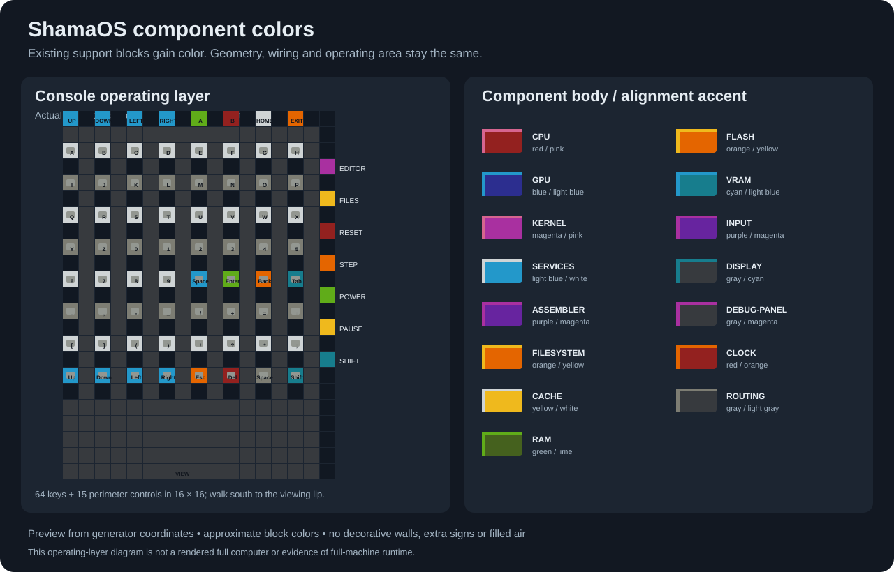
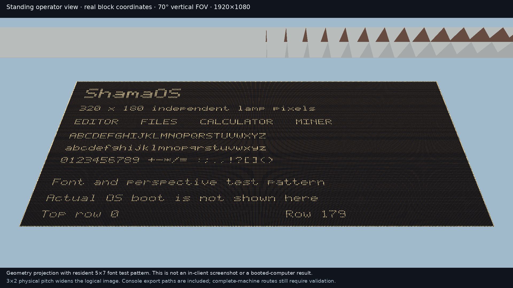

# Component colors

The full-world writer colors existing stone supports after every circuit and
route has been placed. Components use a body color with two-block alignment
stripes every 64 blocks. The console has a dark deck, alternating light keyboard
rows, and colored action controls. No new walls, support frames, signs, platforms
or filled air are added. The block positions, placement count, occupied chunks,
world height and perimeter are unchanged by this pass.

The preview is a diagram of actual console coordinates and the color legend.
It omits the overhead circuitry so the operating layer is readable; it is not a
full-machine render. Regenerate it with
`PYTHONPATH=src python tools/render_appearance_preview.py`.

## Legend

| Component | Body | Alignment accent |
|---|---|---|
| CPU | Red | Pink |
| GPU | Blue | Light blue |
| Kernel | Magenta | Pink |
| OS services | Light blue | White |
| Assembler | Purple | Magenta |
| Filesystem | Orange | Yellow |
| Cache | Yellow | White |
| RAM | Green | Lime |
| Flash | Orange | Yellow |
| VRAM | Cyan | Light blue |
| Input circuitry | Purple | Magenta |
| Display | Gray | Cyan |
| Debug panel | Gray | Magenta |
| Clock | Red | Orange |
| Routes outside components | Gray | Light gray |

The physical cache, RAM and VRAM share horizontal space but retain separate
colors at their actual stacked heights and decoder columns. Synthesized logic
uses its actual cell and terminal bounds, rather than the much larger routing
reservations in the planning diagram.

On the console, directions are light blue; A/Power are lime; B/Reset are red;
Home is white; Exit/Step are orange; Editor is magenta; Files/Pause are yellow;
and Shift is cyan. These colors identify the existing button backings. The
buttons, switches, target blocks and signal circuits keep their exact states.
The operating-layer preview includes the short south viewing lip. The upright
screen has a separate deterministic perspective preview, generated from the
real lamp and console coordinates with
`python tools/render_operator_view.py` (Pillow required). It writes
`build/upright-display/operator-view.png` and its camera metadata. The test
pattern uses the resident 5×7 font and is explicitly labeled as a geometry
projection, not an in-client screenshot or a booted OS result.

The retained [camera metadata](evidence/upright-display-camera.json) and
[circuit/view checkpoint](evidence/upright-display-checkpoint.json) distinguish
the measured fixture results from the remaining full-world gates.

At the documented standing position, conservative rays to all 57,600 lamp
centers clear the native console and its 30 export paths. The entire face also
fits the documented 70° vertical-FOV, 16:9 projection. The 3×2 physical pitch
widening is visible in that preview. See [CONTROLS.md](CONTROLS.md#screen-viewing-position)
for exact coordinates and camera limits. Full-machine routes and in-client
legibility remain separate gates; coloring supports does not establish either.

## Electrical preservation

Only `minecraft:stone` without properties is eligible for replacement. The
replacement is an opaque full-cube concrete block. Existing concrete, dirt,
grass, bedrock, lamps, buttons, wires, repeaters, comparators and torches are
untouched. Color is determined by coordinate, including at supports emitted by
multiple routing stages, so valid shared supports cannot become contradictory
placements. A compact boundary index makes lookup depend on component boundary
count rather than the size of the routed world.

`tests/test_appearance.py` verifies identical coordinates and counts, unchanged
non-stone states, collision-safe shared supports, region boundary precedence,
the colors of the first and last bank in every memory pool, and actual console
actuator positions. Its runtime checks exercise all 16 concrete colors in a
real MCHPRS latch, then save and independently reopen colored memory, display
and console fixtures before exercising their actual redstone. The console
checks all 79 actuators; memory checks addressed writes, read masking and
retained neighboring words; display checks every pixel during repeated row
updates. These fixture proofs do not assert complete-machine timing or runtime.

The generation manifest records the full palette, component region bounds,
control positions, zero added/moved blocks, and a source hash for the appearance
module. The exported schematic derives its states from the generated world,
so it can retain the same component colors.

## Design references and compaction assessment

These upstream projects were inspected on 2026-11-12:

- [CraftGPT, by sammyuri](https://github.com/sammyuri/craftgpt): an example of a
  large repeated redstone machine and an honest distinction between native
  redstone behavior and an accelerated runtime. Its public repository contains
  model data and an emulator, not a reusable colored physical-cell library.
- [ibedard16 / Ronnocskeew's redstone computer](https://github.com/ibedard16/minecraft-redstone-computer):
  its README explicitly identifies seven functional groups by support color,
  including green memory, red registers, a contrasting data bus, and purple
  user controls. That readable component-color convention informs this design.
- [sammyuri's Minecraft schematic generator](https://github.com/sammyuri/minecraft/tree/main/schemgenerator):
  the source uses fixed component templates and exact state palettes. Its
  `worldschem.py` includes green terracotta supports and folded coordinates for
  its particular memory layout. This supports investigating repeated local
  templates; it does not establish that ShamaOS can substitute that memory
  layout without a new capacity, timing and redstone proof.

No upstream circuit, texture or schematic was copied into this change. Coloring
existing supports is footprint neutral and does not itself reduce delay. No
new density or speed result is claimed from appearance alone. Electrical
compaction remains a separate measured change, with its own real-engine tests.
