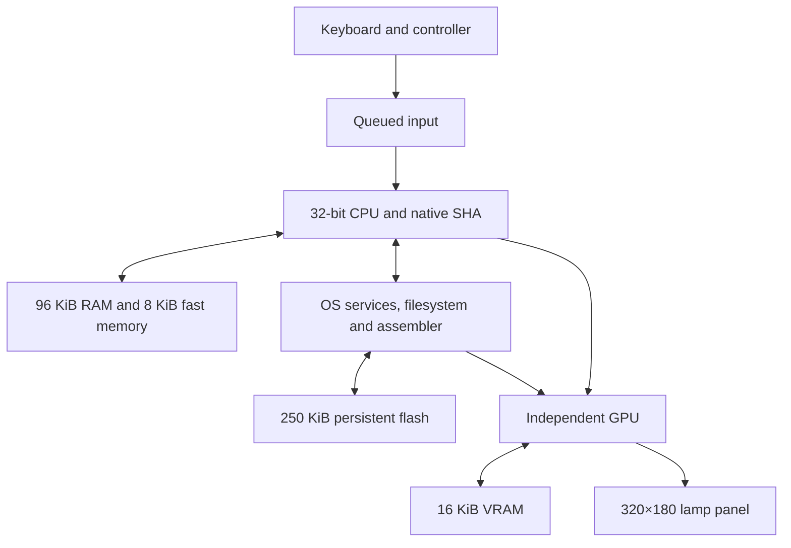

# ShamaOS Architecture

ShamaOS is a 32-bit redstone computer generated as one synthesized SoC plus large regular memory/display/input fabrics.

## CPU

32-bit datapath, 16 GPRs, integer ALU, multiply/divide/modulo, shifts/rotates, flags, branches, calls/returns, load/store, syscalls, stacks and counters. SHA primitives plus SHA256/DSHA256/HASHCMP/INCNONCE are native CPU operations.

## Timing

A fast raw clock feeds input/event capture. Core divider bit 17 is the default for CPU/GPU/services/filesystem/assembler/memory controllers. On reset, core clock follows raw clock.

The physical raw clock has a 70-redstone-tick period. Bit 17 divides by
262,144, so the current default core period is 18,350,080 redstone ticks
(about 21.24 days at normal 10 redstone ticks per second). This is an extremely
slow provisional setting, not a measured usable machine speed or proof of
safe timing. Reducing it requires actual route-delay, clock-skew and hold-time
validation. Local routing and memory-controller work target those costs; a
faster file exporter does not make a running CPU instruction faster.

## Memory

Literal default capacities:

- cache 8 KiB / 2 banks;
- RAM 96 KiB / 24 banks;
- flash 250 KiB / 62 full banks plus one 2 KiB bank;
- VRAM 16 KiB / 4 banks.

Each full bank contains 4 KiB (1,024 × 32-bit words). Flash's final bank contains
512 words / 2 KiB, so its 63 bank modules provide exactly 250 KiB without padded
storage. The owner approved the current capacities on 2026-11-12; screen, input,
assembler, compute and OS functionality remain required.

The controller checks each requested byte address against the exact installed
capacity. An in-range request latches its bank and word-row address directly;
there is no rotating bank/row seek or wraparound of an invalid address.
Out-of-range requests are rejected before changing those address latches or
starting a read/write transaction. Bank selects cover exactly the installed
modules, including the non-power-of-two RAM/flash counts. A ten-bit binary row
address reaches each tile's physical decoder instead of 1,024 system-wide
row-select wires.

## GPU/display

Large GPU state is external VRAM. The 320×180 panel is a horizontal X/Z latch matrix viewed from above and receives 320 data bits plus 180 one-hot row selects.

## OS/storage

ShamaFS is hardware. The in-world assembler is a hardware two-pass assembler. Boot loads resident kernel RAM plus one foreground app mirrored into the 8 KiB fast cache.

## Physical synthesis

Regular memories/display/input are custom generators. Stateful control logic is synthesized from SystemVerilog with Yosys into redstone cells, placed in 2-D and routed on isolated planes.

Python/Yosys are build tools only; generated runtime behavior is performed by the redstone machine.
