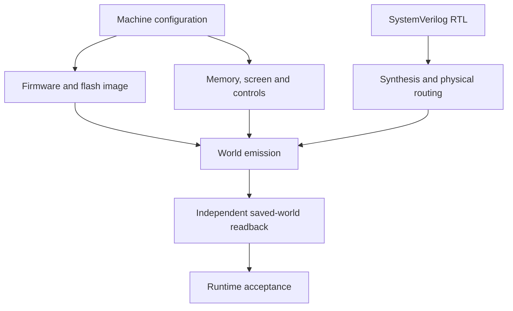

# Hardware and world generation

## Pipeline



Each stage has its own validation. A complete runtime result is not implied by
successful emission or a mapped netlist. The target is Minecraft Java 1.20.4,
DataVersion 3700, with all physical computation performed by emitted redstone.

## Regular fabrics

The default image reserves 2 cache, 24 RAM, 63 flash and 4 VRAM bank modules.
All are 4 KiB except the final flash bank, which contains exactly 512 words /
2 KiB. Flash is initialized from the assembled 250 KiB ShamaFS image. Compact
memory cells use locked repeaters and isolated read/write buses; see
[MEMORY.md](MEMORY.md) for counts, stacking work and initialization details.

The superflat grass surface is a protected lower boundary. Storage begins with
its lowest support one block above grass, and automatic stacking reserves the
upper routing canopy. The default four-layer grass world fits 30 layers at
12-block spacing; a Y=63 grass preset fits 20. Fewer layers create more
horizontal groups without changing capacity. All component and route supports
must pass the same above-ground check as the memory cells.

The display is a horizontal 320×180 X/Z panel, viewed from above, with a locked
latch per lamp, five-block column pitch and four-block row pitch. The full
57,600-pixel panel passes actual-engine retention/isolation checks. Its view
from the operator console still needs integration. Physical keyboard/controller, Shift,
power/reset/pause/step, clock and architectural debug lamps form the interface.

## Logic mapping

CPU/native SHA, GPU, display bridge, input, OS services, GUI kernel, ShamaFS,
in-world assembler and each memory adapter are separate synthesis partitions.
The black-boxed `shama_soc` shell is mapped separately and connects their actual
port positions. This retains the integrated hierarchy while avoiding a single
monolithic flatten/ABC pass.

The mapper emits the supported BUF/NOT/AND/NAND/NOR/DFF technology cells and
lowers supported clock enables and synchronous-reset variants with their exact
polarities/reset/enable priority. It probes installed ABC options and explicitly
rejects unsupported sequential semantics rather than guessing.

The assembler computes numeric values incrementally during the existing source
reads. Its eight-byte prefix store serves register/quoted-byte decoding; the
full token still feeds the symbol hash, and a separate last-character register
preserves label/quote termination. Sharing this arithmetic reduces the matched
mapped logic by 24.26% without adding assembly cycles. See
[implementation status](IMPLEMENTATION_STATUS.md) for the measured baseline,
regression scope and remaining full-routing gates.

## Routing and timing

Internal nets and system interconnect use separated routing planes. Stair
transitions require supported dust and legal flat repeater positions before
signal strength expires. Directed boundary repeaters isolate fanout branches.
Allocators must account for other wires/supports and component obstacles,
including the complete pin escape path.

Actual-engine tests exercise representative nets and placed sequential cells.
They do not substitute for complete-machine electrical isolation, fanout and
clock-skew/hold closure. The default divided core clock remains conservative;
its setting cannot alone prove timing safety. Raw inputs continue through the
physical clock while the CPU is paused; single-step grants a complete core pulse.
Power-off requests keep the clock available for save/cleanup before stopping.

## Native world backend

`create-world` makes a new owned grass superflat Java save. Every touched chunk
retains complete bedrock/dirt/grass terrain, and writes at or below the grass
are rejected. Existing flat-layer settings determine the grass datum. The
native backend emits compressed
Anvil chunks, correct chunk coordinates and exact block properties, with a
bounded chunk cache and explicit build-height/world-border checks. Conflicting
block assignments fail. Successful generation with `validate_after_write=true`
reads the actual files back and compares their saved block-state content.
Reports include source/version identity and distinguish file fidelity from
runtime proof.

An optional Amulet backend handles existing unrelated saves. Native code does
not discard unknown metadata to pretend it supports arbitrary-world editing.
No giant setblock script, command-block implementation or runtime Python CPU is
used.

## Resource accounting

Before full emission, `generation-preflight` validates the fixed capacity contract
and reports both storage-only costs and the measured regular-component profile.
The latter includes storage, local memory controls/returns and binary decoders,
the screen, keyboard/controller circuitry, debug panel and clock. Its occupied
X/Z chunk count is a union: vertically shared chunks are counted once. Placement
counts describe emission operations, which can include repeated identical
supports. Anvil sector/header costs are disk lower bounds, not forecasts of the
compressed save size.

After mapping the partitions and shell, `generate` also invokes
`prepared_system_resource_preflight` and writes `mapped-resource-preflight.json`.
That analysis includes literal mapped-cell placement counts and analytical
routing lower bounds for every partition, the shell and the global interconnect.
Each routing bound covers guaranteed long branch wires in the current
unique-global-track topology; horizontal trunks, stairs and short terminal leads
are additional. The report retains the exact regular-component profile. It takes
the maximum of the regular and individual route chunk/byte lower bounds, rather
than summing overlapping footprints, and leaves the exact whole-machine chunk
count unset. A proven insufficient disk budget stops generation before world
blocks are emitted.

Validation-ledger space, temporary compaction space, compression growth beyond
the minimum sectors and runtime loading costs remain additional or unmeasured.
A fitting lower bound does not establish complete-route validity, safe clock
timing, a workable loading strategy or in-world boot. Bank layout, generation
locality and canonical section reuse need measured results and independent
readback before their claimed savings are updated.

## Commands

```bash
shamaos create-world --world build/ShamaOS --name ShamaOS
shamaos generation-preflight --config configs/default.toml --world build/ShamaOS --report build/resource-preflight.json
shamaos generate --world build/ShamaOS --config configs/default.toml --manifest build/generated-manifest.json
shamaos validate-world --world build/ShamaOS
shamaos validate-manifest --manifest build/generated-manifest.json
```

Use a disposable closed world while writing. The full runtime acceptance and
release evidence requirements are in [VALIDATION.md](VALIDATION.md).
